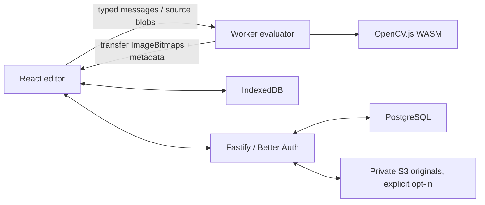

# Architecture

## Execution boundaries

The React UI owns the editable document and selection, not image matrices. A classic browser worker loads the self-hosted OpenCV runtime with `importScripts`. Its compatibility loader wraps the older Emscripten self-resolving thenable; directly awaiting that object would loop indefinitely.

The worker creates matrices from `ImageData` and renders through `OffscreenCanvas`. DOM helpers such as `cv.imread` and `cv.imshow` are not used. An imperative frame store owns transferred bitmaps and closes replaced resources. React/Zustand holds only graph data, result metadata and statuses.

A dependency-ordered evaluation isolates errors to each branch. Valid inputs are immutable; operations create outputs. Disabled operations pass input A through. Graph edits coalesce for 24 ms, carry monotonically increasing revisions, and replace the pending evaluation. Worker yields between nodes permit cancellation without claiming to interrupt a synchronous WASM call. Late frames are closed instead of displayed.

Cache keys are SHA-256 hashes of the OpenCV/operation version, validated parameters, enabled state, source generation, quality scale and upstream hashes. Display names, positions and preview pins do not invalidate image computation. The cache uses LRU eviction at 128 MiB. Full-resolution export computes only the selected output's dependency graph, uses a separate uncached run, and releases matrices after their last consumer. A working-set guard rejects oversized graphs at 256 MiB of live graph matrices; additional decoding/rendering buffers and the runtime heap are separate overhead.

## Document contract

`PipelineDocument` has `schemaVersion: 1`, an ID/name, operation nodes, port-indexed edges, logical source references, preview targets/quality, and a graph viewport. Images, transient errors, signed URLs, OAuth data and matrices are never serialized into the document.

Nodes identify an operation and its version, hold explicit parameters/defaults, an enabled flag, optional source ID, and position. Input 0 is A; input 1 is B. Structural parsing rejects unknown operations, invalid parameters, duplicate identifiers, malformed ports and cycles. Incomplete experiments can be stored locally; evaluation and Python export report missing inputs and mode/dimension incompatibilities rather than silently inserting conversions.

The initial image domains are 8-bit RGBA and grayscale. Grayscale-only tools require an explicit conversion node. Sobel/Laplacian calculate signed derivatives and expose `convertScaleAbs` as an 8-bit visualization. Point/color adjustments preserve alpha; spatial operations process the channels of their input. Combining requires equal shape and color mode. Bypassed operations pass A through.

## Adding an operation

1. Add its versioned metadata, parameter bounds/defaults and explanations to the pipeline registry.
2. Add its OpenCV adapter to `packages/engine/src/operations.ts`, with deterministic cleanup of every temporary matrix.
3. Add a Python expression/helper in the generator with matching normalization and color semantics.
4. Extend real-WASM tests and Python parity coverage. Include boundary/invalid-mode fixtures when the new operation adds an input contract.

UI controls derive from parameter metadata; the engine and API share the same schema. The registry stays serializable; executable adapters/generators live in their owning packages and dispatch using the registry identifier.

## API and persistence

`/api/auth/*` delegates to Better Auth with correct multiple Set-Cookie forwarding. `/api/config` exposes configured provider names, never secrets. Sessions use signed HttpOnly cookies. State-changing API requests validate browser origins and routes are rate limited.

| Endpoint                                    | Behavior                                             |
| ------------------------------------------- | ---------------------------------------------------- |
| `GET /api/health`                           | Liveness/configuration                               |
| `GET/POST /api/v1/projects`                 | Owner-scoped list/create                             |
| `GET/PUT/DELETE /api/v1/projects/:id`       | Owner-scoped load, compare-and-swap update, deletion |
| `PUT /api/v1/projects/:id/assets/:sourceId` | Opt-in-gated raw PNG/JPEG/WebP upload                |
| `GET /api/v1/projects/:id/assets/:sourceId` | Authenticated private image download                 |

Project writes contain `{ document, syncImages, revision? }`; revision is required for updates. An atomic database predicate on ID, owner and revision prevents lost updates. Responses omit owner internals. Missing/foreign projects return 404; stale writes return 409. Uploads are capped at 20 MiB, inspect image metadata and magic bytes, reject animated inputs and verify source dimensions/format. Object keys are server-generated. A row lock rechecks image opt-in when committing an upload. Opt-out removes the asset references and cloud objects; project deletion also cleans associated objects. Storage cleanup failures are logged for operator attention.

IndexedDB stores documents, blobs, last-opened project and cloud acknowledgements. Local saves continue without network access. A cloud binding records the last acknowledged document/revision; reloading does not turn an existing cloud project into a new create. A save acknowledges the graph before uploading optional images, so an image retry uses the correct revision. SHA-256 fingerprints suppress unchanged uploads. Autosave waits for in-flight writes and follows up when newer edits remain; conflicts stop automatic cloud writes and preserve local changes for Save as a new copy.

## Validation and operations

Vitest covers contracts, actual WASM operations and injected API behavior. Opt-in integration tests exercise real PostgreSQL compare-and-swap, Better Auth signed sessions and S3 object lifecycle. Playwright covers desktop/mobile editing, offline use, recovery, exports, branch errors, scheduler behavior and memory/performance in Chromium, Firefox and WebKit. Python parity runs generated programs against controlled RGBA fixtures.

CI runs all checks, builds, integration/parity tests and browser coverage. No database migration runs automatically on API startup; deployment applies the explicit migration before starting the new service. Fastify emits structured request/error logs without logging source pixels or OAuth credentials. Guest mode remains available when cloud configuration is absent.
