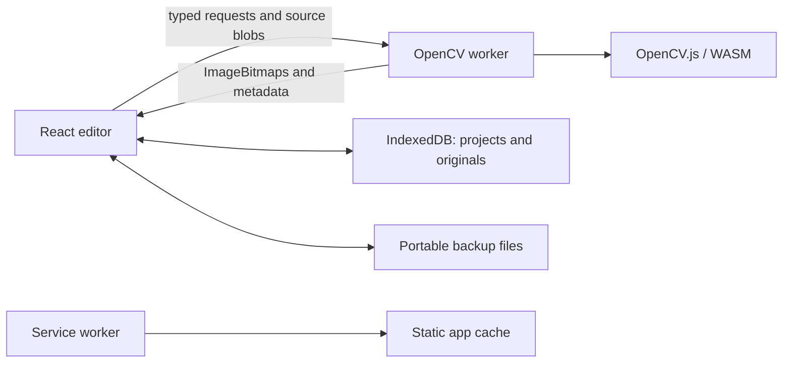

# Architecture

## Boundaries

OpenCV WebLab is a static React/Vite app. There are no server APIs, accounts or image uploads.

`packages/pipeline` owns registry metadata, schemas, graph validation/editing and Python generation. `packages/engine` owns OpenCV adapters, the dependency evaluator, worker protocol and imperative frame store. `packages/ui` supplies accessible shared controls. `apps/web` owns the editor, project persistence, backups and offline lifecycle. `packages/config` supplies strict TypeScript settings.

## Execution and analysis

A classic worker loads the pinned OpenCV runtime relative to its own URL. The compatibility loader wraps Emscripten's self-resolving thenable rather than directly awaiting it. Source decoding and matrix processing use OffscreenCanvas; DOM-only `cv.imread`/`cv.imshow` helpers are not used.

Evaluation follows dependency order and isolates branch errors. Edits coalesce for 24 ms and carry increasing revisions. A newer request replaces pending evaluation; cancellation yields between operations, not during synchronous WASM calls. Superseded frames are closed. The frame store owns transferred bitmaps outside React/Zustand; replacing a frame closes the old resource.

Cache keys include runtime/operation versions, parameters, enabled state, source generation, preview scale and upstream hashes. Labels, positions and preview pins do not invalidate computation. An LRU bounds cached matrices at 128 MiB; a graph working-set guard rejects more than 256 MiB of live matrices. Full-resolution export evaluates only the requested dependency graph without populating the preview cache. A 60-second watchdog exposes restart recovery.

Output-B inspection clones the displayed bitmap into the worker, which keeps one analysis ImageData buffer. Requests and replies carry frame revision, node and request identifiers; stale analysis and pixel samples are ignored. Histograms and pixel values describe displayed preview pixels. Canvas transforms invert the exact fit/zoom/pan mapping; device-pixel-ratio changes affect canvas backing resolution, not the definition of 100% zoom.

## Documents and edits

Learning requests share the processing worker. Pixel explanations transfer only a cropped neighborhood (at most 7×7), use the active output-B analysis buffer, and reject obsolete request/revision identifiers. Gaussian weights are derived from the pinned runtime’s floating-point impulse response and quantized with symmetric error-carry normalization to model its 8-bit coefficient path. Numerical tests compare the resulting sums with actual WASM outputs, including borders, clipping and preview scaling. No operation is described as linear unless explicitly supported.

Parameter comparisons transfer one input bitmap and evaluate three variants sequentially, capped at 1,024 pixels on the input’s longest edge. They use separate cancellation generations and return transferable frames to a dedicated imperative FrameStore. React stores only comparison metadata; closing, editing, exporting or restarting releases these frames. The graph and normal intermediate cache remain unchanged until the user applies a value. Resize and multi-input operations are excluded. Temporary comparison matrices are deleted after each variant; stale bitmaps are closed by the receiver.

Documents may carry an optional `lessonId` referencing one of the bundled activities; old schema-version-1 documents remain valid. Local prediction/reflection text and completion flags live in namespaced IndexedDB settings, outside portable documents. Progress is independent of project names, isolated between project IDs, and removed when a project is deleted. A failed progress write is labeled temporary without claiming a durable save.

`PipelineDocument` remains `schemaVersion: 1`. It contains nodes, versioned operation parameters, port-indexed edges, logical source references, A/B preview targets and a graph viewport. It never embeds images, matrices, credentials or temporary runtime errors. Input 0 is A; input 1 is B. Parsing validates operations, parameters, identifiers, ports and cycles, while allowing incomplete experiments.

The image model is 8-bit RGBA or grayscale. Grayscale-only operations require an explicit conversion node. HSV masking explicitly converts inside its documented operation and returns grayscale; it does not introduce an HSV graph domain. Disabled operations pass input A through. Two-input operations require equal dimensions. Existing merges also require equal modes; Apply mask declares per-port contracts allowing a grayscale or RGBA image on A and a grayscale mask on B. New difference/XOR tools preserve input A's alpha; sharpen preserves source alpha.

Insertion validates both replacement connections before committing. Batch duplication remaps internal edges and retains valid incoming references; it does not duplicate external outgoing connections. Source blobs are immutable and may be shared. Selection/follow state is editor state, while the chosen preview targets and viewport persist in the document. History holds at most 50 snapshots; each gesture or batch action creates one checkpoint.

## Local persistence and portability

IndexedDB retains the legacy database identifier `roveran` at version 2 so rebranding preserves existing experiments, together with the original `projects`, `assets` and `settings` stores. Migration removes obsolete `cloud:*` settings without deleting graphs, blobs or `lastProject`. Project records preserve the v1 shape with an `updatedAt` field. Writes are serialized. In-memory records keep the latest session recoverable if persistence fails; UI status never treats that fallback as a successful durable save.

Reconnection allocates a new source ID. Garbage collection considers every saved project, session record, active history snapshot and pending image before deleting blobs. Imported images and their project are written in one transaction; failure aborts durable writes and retains session data for a backup.

A `.opencv-weblab.zip` contains `manifest.json` (`format: opencv-weblab-project`, version 1), `project.json` and `assets/<sourceId>.<png|jpg|webp>`. Imports also accept the legacy `roveran-project` format. The manifest maps logical source IDs to those entries. Already-compressed originals use ZIP STORE. Import checks entry paths, duplicates, counts and expanded sizes before decompression, then validates the document, image signatures, dimensions and references before writing. Imports get fresh project/source identifiers. Graph-only JSON stays portable independently of this container format.

## Offline build

Vite's configured base path is applied at request boundaries; logical built-in references in old JSON stay unchanged. The generated service worker precaches hashed UI assets, fonts, samples, the engine worker and OpenCV runtime. Its per-file ceiling explicitly accommodates the approximately 10 MiB runtime. Development does not register a worker.

The app reports offline readiness only after installation or an existing controlling worker. Updates wait for an explicit action; pending edits flush before activation. A failed save requires a portable backup before reload. Browser storage/cache eviction can still remove local work. Production is served from `apps/web/dist` over HTTPS or localhost, with no backend configuration.

## Object measurements

Operation execution can return a matrix plus typed component or contour rows. The image-only adapter remains available to existing callers. The evaluator caches rows with their image, accounts for serialized metadata bytes and sends them through NodeResult. Derived measurements never enter project documents or IndexedDB. Schema version 1 remains unchanged.

Integer component labels and contour vectors stay inside the worker. Components receive canonical IDs from the first foreground pixel in raster order. External contours sort by their earliest raster boundary point. This spatial ordering and the deterministic label palette are shared with generated Python. Component pixel area counts nonzero pixels; contour area measures the outer polygon and includes enclosed holes. Degenerate contour centroids are null.

Analysis checks a conservative scratch estimate against the remaining 256 MiB graph working budget before entering WASM and rejects more than 10,000 objects. Label matrices, contour vectors and individual contour handles are deleted on success and failure. Per-node cache entries include metadata; full measurement evaluation leaves the preview cache unchanged.

The measure worker request carries revision, request ID, document and node ID. Its separate generation cancels superseded requests and evaluates only target dependencies at scale 1, without PNG encoding or preview caching. Results pair rows with a transferable bitmap. A dedicated FrameStore owns that bitmap; closure, edits, exports and engine restart release it. Stale responses close their bitmap. Full results are held in memory for the dialog and CSV export. Preview table coordinates use the current image transform for bounding-box highlights.

## Image-tool extension

The registry marks Resize, Crop and Perspective correction with `changesDimensions`; both comparison UI and worker eligibility use this flag. Dimension inference accounts for enabled geometry nodes and preserves input dimensions when bypassed. Crop percentages describe input image boundaries (floor left/top, ceil right/bottom); perspective percentages map to input pixel centers. Both share geometry helpers with the processing layer. Perspective validates convex clockwise source corners and requires input dimensions of at least 2×2 pixels.

Toolkit execution keeps the existing 8-bit gray/RGBA contract. Hough line segments and circles and Shi–Tomasi corners render opaque RGBA annotations; empty results retain the grayscale input appearance. Hough lines clone the input before detection. All native handles and temporary matrices are released on success and failure. Conservative scratch/output estimates are checked against remaining graph working memory, and detections are capped at 10,000. Distance transform converts its float map to a normalized 8-bit visualization and rejects inputs without zero background pixels. Color maps convert OpenCV BGR results to RGBA.

Preview spatial distances and line votes scale with the evaluation scale; CLAHE tile counts, intensity thresholds and dimensionless controls do not. Python export uses equivalent full-resolution algorithms, coordinate rounding, annotations and color conversions. The three new deterministic fixtures are included by the existing sample precache glob and source allowlist. Schema version 1 and worker message shapes are unchanged.
