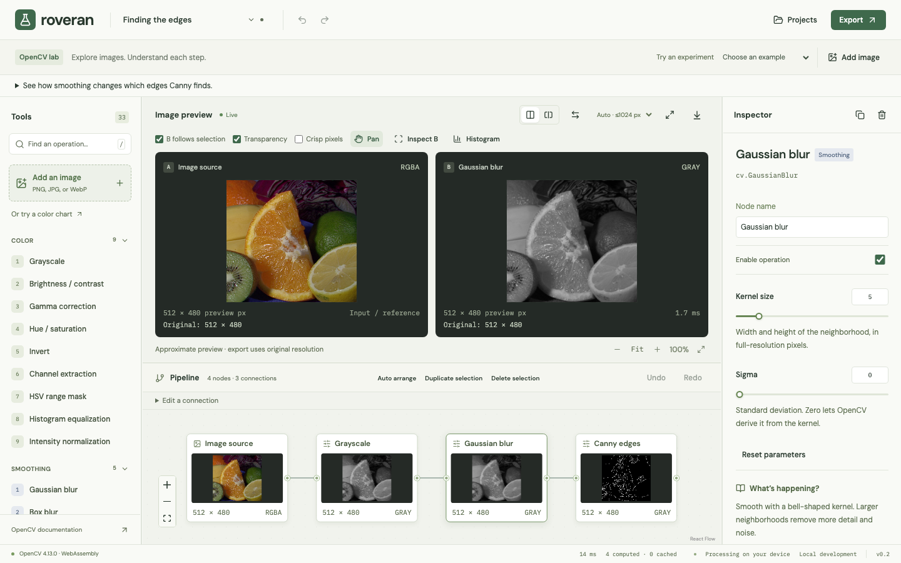

# Roveran

An open-source OpenCV learning lab. Connect image operations, adjust their parameters, and see what happens at every step. No account, API, database or image upload is required: processing runs in a WebAssembly worker on your device.



## Start exploring

Requires **Node.js 24** and **pnpm 11.28.9** (see `.nvmrc` and `package.json`).

```sh
pnpm install --frozen-lockfile
pnpm dev
```

Open [localhost:5173](http://localhost:5173). The repository includes OpenCV 4.13.0, two general sample images and seven synthetic learning images; no runtime CDN is needed. Select a node to change its parameters. Click a tool to append it to the selected node, or drag it onto the graph to place it independently. Drop a single-input tool onto a connection to insert it.

Roveran is for students, curious developers and people learning image processing. Its roadmap prioritizes clear explanations and reproducible experiments. It is an educational tool, with no industrial suitability or operational guarantees. The Apache-2.0 license permits commercial and industrial use.

## Learn by experimenting

The library contains **37 processing tools**, plus image sources: color adjustments and channels, HSV masks, smoothing and sharpening, thresholding, edges, morphology, geometry, blends, bitwise comparisons and object analysis. The Inspector explains inputs, outputs, parameters and a suggested experiment, with a Python expression and a link to the OpenCV documentation.

Thirteen examples include objectives, hints and optional Predict → Try → Compare → Reflect activities. Prediction notes, reflections and learner-confirmed progress save per project in this browser, independently of its name. They are not grades and are not included in portable backups.

| Experiment                  | What to look for                                            |
| --------------------------- | ----------------------------------------------------------- |
| Finding the edges           | Smoothing and Canny thresholds                              |
| Shapes from light           | Thresholding and closing small gaps                         |
| Two ways to see             | Gaussian versus median smoothing                            |
| Finding a color             | HSV ranges and color isolation                              |
| Reading the histogram       | Equalization versus normalization                           |
| What sharpening changes     | A difference image revealing affected pixels                |
| A noisy neighborhood        | Median versus Gaussian blur on isolated noise               |
| Light is not even           | Global versus adaptive thresholds under uneven illumination |
| Closing the gaps            | Kernel shape and size on thin splits and small holes        |
| A narrow range of light     | Contrast transformations on a controlled ramp               |
| When pixels belong together | Four versus eight connectivity and object counts            |
| Two meanings of area        | Pixel counts versus outer contour area and perimeter        |
| Keep the useful objects     | Area filtering followed by masking original pixels          |

Seven examples use original, deterministic grayscale fixtures generated by `scripts/generate-learning-images.py`. They require no downloads or model weights and are included in the offline app. The [learner-session guide](docs/learning-validation.md) describes how to check whether these activities help students explain an image change; automated checks alone do not establish that.

**Connected components** counts nonzero grayscale regions and colors their labels. **Contour analysis** draws external boundaries and measures their geometry. Open **Measurements** below output B to inspect counts, area, centroids and bounding boxes; focus an ID to highlight its bounds. Preview values describe displayed pixels and may miss or merge small objects. Choose **Measure full resolution / CSV** to recompute that step from originals, inspect the matching image and download precise CSV values.

**Filter objects by area** keeps complete regions within inclusive bounds expressed in full-resolution input pixels squared. **Apply mask** copies grayscale or RGBA image A wherever grayscale mask B is nonzero, clearing other pixels to black or transparency. Image and mask dimensions must match. See the [object-analysis guide](docs/object-analysis.md) for definitions, limits and Python reproduction.

Choose **Explain a pixel**, then point at output B or use its arrow keys. For grayscale Box blur, Gaussian blur and Sharpen, the lab shows the input neighborhood, kernel weights, contributions, clipping and the actual OpenCV output. **Show this input in A** links the neighborhood outline to the source of that operation. The first release supports preview kernels up to 7×7; other filters remain fully usable without a pixel calculation. Gaussian explanations model the pinned runtime’s symmetric 8-bit fixed-point weights; displayed decimal weights are rounded. Border samples use `BORDER_REFLECT_101`.

Select a single-input numeric filter and choose **Compare three values** in the Inspector. Generate three operation previews from the same input, then apply a value as one undoable edit. Generating comparisons does not add graph nodes or change parameters. Comparisons are approximate, cap the input at a 1,024-pixel longest edge, and scale spatial parameters. Editing the graph or closing the panel cancels pending work and releases temporary frames. Resize and multi-input operations are excluded from this initial comparison tool.

The viewer supports synchronized pan/zoom, side-by-side and wipe comparison, stable A/B pins, transparency, nearest-neighbor display, output-B pixel inspection and histograms. **Fit** scales to the panel; **100%** means one preview pixel per CSS pixel. Auto preview is approximate and caps the longest source edge at 1,024 pixels. Full-resolution preview and PNG export use original-resolution parameters. Histogram and pixel readouts describe displayed preview pixels, including browser color/alpha normalization.

## Keep your experiments

Projects and originals autosave to **IndexedDB in this browser and origin**. The save indicator distinguishes saved work from a temporary session or failed save. Browser data can be cleared or evicted, so download backups of work you want to keep.

- **Portable backup (`.roveran.zip`)** includes the pipeline and original images. Importing creates an independent experiment with fresh project and asset identifiers.
- **Pipeline JSON** stores the graph and logical source references. Reconnect missing images after importing it elsewhere. Existing schema-version-1 JSON remains supported.
- **Python / OpenCV** exports a complete script with input filenames, helpers and explicit color conversions. Install the dependencies listed in its header and place the original images beside the script.
- **PNG** exports output B at original resolution.

Projects can be searched, renamed, duplicated and deleted in Projects. Image replacement never changes the original bytes used by another experiment. No images or projects are sent to a server. There is no analytics or telemetry in the app.

## Offline and static hosting

```sh
pnpm build
pnpm start
```

Deploy **`apps/web/dist`** to a static host using HTTPS (localhost also works). Node is needed for development/building, not for the deployed app. Configure HTML/service-worker files to revalidate, and avoid rewriting missing `.js` files to HTML. No server endpoints or environment secrets are needed.

For subdirectory hosting:

```sh
ROVERAN_BASE_PATH=/roveran/ pnpm build
```

After the first successful production visit, **Ready offline** confirms the app, fonts, samples and OpenCV runtime have been cached. It can then reopen without internet access while the browser retains that cache. Development mode does not install a service worker. An available update waits for **Save and update**; failed saves require a portable backup before reloading. Clearing site data removes both experiments and offline files.

## Keyboard and graph controls

| Action                            | Control                                                               |
| --------------------------------- | --------------------------------------------------------------------- |
| Search tools                      | `/`                                                                   |
| Undo / redo                       | Ctrl/Command-Z / Ctrl/Command-Shift-Z                                 |
| Multi-select                      | Shift, Ctrl or Command while selecting nodes                          |
| Duplicate selected nodes          | Ctrl/Command-D while the graph is focused, or the toolbar             |
| Remove selection                  | Delete / Backspace, or the toolbar                                    |
| Insert or disconnect a connection | **Edit a connection**, or Inspector input controls                    |
| Pan image / zoom                  | Drag or pinch; wheel over a preview                                   |
| Viewer shortcuts                  | Focus a preview: arrows pan, `+`/`-` zoom, `F` fits, `1` selects 100% |
| Inspect pixel                     | Choose **Inspect B**, then point at B or use its arrow keys           |
| Exit expanded viewer              | Escape                                                                |

Auto arrange lays out the graph from left to right. Gestures and batch edits undo as a single action. The Inspector provides keyboard alternatives to connecting ports, insertion and deletion. Smaller screens expose Tools, Workspace and Inspector through panel navigation.

## Contribute

See [CONTRIBUTING.md](CONTRIBUTING.md), [ARCHITECTURE.md](ARCHITECTURE.md), [ROADMAP.md](ROADMAP.md) and the [release validation](docs/validation.md). Bug reports should include reproduction steps and browser details; use sample images whenever possible. Never attach private images without checking their contents.

```sh
pnpm check                    # lint, typecheck, unit/WASM tests, production build
pnpm format:check
pnpm exec playwright install chromium firefox webkit
pnpm test:e2e
python3 -m venv /tmp/roveran-python
/tmp/roveran-python/bin/pip install -r tests/requirements.txt
ROVERAN_PYTHON=/tmp/roveran-python/bin/python pnpm test:parity
```

## Limits and compatibility

PNG, JPEG and still WebP inputs: at most 20 MiB, 16 megapixels and 16,384 pixels per edge. Projects support 100 nodes, 250 connections and 20 sources. Portable backups enforce those limits before importing images. Use current Chromium, Firefox or Safari with WebAssembly, workers, OffscreenCanvas and ImageBitmap support.

The intermediate-matrix cache is bounded at 128 MiB and graph working matrices at 256 MiB. Display bitmaps, a bounded output-B analysis buffer, image decoding and the WASM heap add overhead. Large images and many branches may exceed device memory. Cancellation occurs between OpenCV calls; a 60-second watchdog offers an engine restart. Original image decoding, ICC profiles, EXIF orientation and native Python rounding can differ. Use normalized PNG fixtures for exact comparisons.

Camera/video, AI, collaboration and industrial integrations are outside this release.

## License and attribution

[Apache-2.0](LICENSE). See [NOTICE](NOTICE) for OpenCV, samples and font attribution. Production builds include dependency licenses. `pnpm runtime:fetch` verifies or restores the pinned runtime using its recorded checksum; it does not silently upgrade OpenCV.
